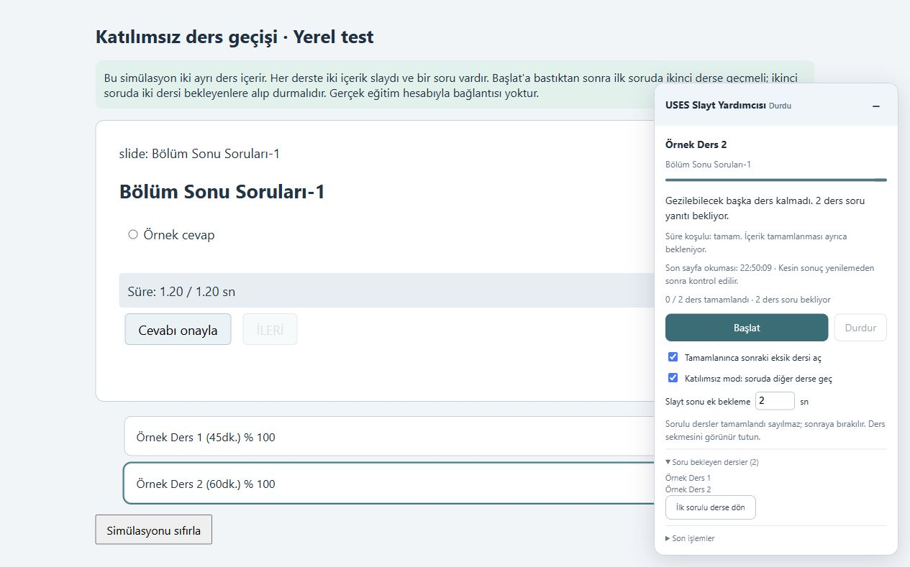

# USES Slayt Yardımcısı

**V1.2 alpha** · Chrome eklentisi

Sağlık Bakanlığı USES eğitimlerini takip eden kullanıcılar için hazırlanmış Türkçe Chrome eklentisidir. Slaytların süresini bekler, dersin tamamlanma durumunu kontrol eder ve uygun dersler arasında otomatik geçiş yapar. Katılımsız modda soru bulunan dersleri daha sonra yanıtlamanız için bekleyenlere alır.



## Özellikler

- Slaytın zaman çizgisi dolduğunda ve **İLERİ** etkinleştiğinde ilerler; geçişi kontrol eder.
- Ders süresi ile içerik tamamlanmasını ayrı gösterir.
- Bölüm sonunda gereken süreyi bekleyip sayfayı yeniler; yeni yüzde ve **Tamamlandı** etiketini kontrol eder.
- Tamamlanan dersin ardından sonraki eksik dersi açar.
- **Katılımsız mod** açıkken sorulu dersi bekleyenlere kaydeder; aynı dersler arasında döngü oluşturmaz.
- Bekleyen sorulu derse tek düğmeyle dönülebilir. Soruları otomatik yanıtlamaz.
- Başlat/durdur, ek bekleme süresi ve oturum boyunca durum koruma bulunur.

## Chrome'a kurulum

1. GitHub sayfasındaki **Sürümler** bölümünden `uses-slayt-yardimcisi-v1.2-alpha.zip` paketini indirip bir klasöre çıkarın.
2. Chrome'da `chrome://extensions` adresini açın ve **Geliştirici modu**nu etkinleştirin.
3. **Paketlenmemiş öğe yükle** ile `manifest.json` içeren klasörü seçin.
4. USES eğitim sekmesini yenileyip panelde **Başlat**'a basın.

Bilgisayar başından ayrılmadan önce **Katılımsız mod: soruda diğer derse geç** kutusunu açık bırakın. Kullanıcı varlığı otomatik algılanmaz. Ders sekmesi görünür kalmalıdır.

Ayrıntılı davranış ve güncelleme adımları: [KURULUM.md](KURULUM.md).

## Gizlilik

- Hesap bilgisi, parola, çerez veya kişisel iletişim bilgisi toplamaz.
- Harici bir hizmete veri göndermez; yapay zekâ bağlantısı veya anahtar gerektirmez.
- Yenilemeden sonra devam edebilmek için çalışma ayarlarını, ders kimliklerini, soru bekleyen derslerin adlarını ve zaman bilgilerini yalnızca açık sekmenin oturum alanında tutar.
- Ayrı bir kullanıcı hesabı veya ek tarayıcı izni istemez.

## Çalışma alanı

Yalnızca `https://egitim.saglik.gov.tr/EgitimIzle/*` adreslerinde çalışır. Sayfada görünen ders listesi ve oynatıcı kontrollerini kullanır. Sitenin süre ve tamamlanma değerlerini değiştirmez; soru bekleyen veya süresi eksik dersleri tamamlandı saymaz.

**Alpha durumu:** Yerel simülasyonlar ve 51 davranış testi geçti. Gerçek Chrome/USES üzerinde tam ders akışı henüz uçtan uca doğrulanmadı. Site oynatıcısı değiştiğinde bekleme veya durma gerekebilir.

## Test ve geliştirme

Bağımlılık kurulumu gerekmez; testler için Node.js kullanılır:

```sh
npm test
npm run demo:prepare
python -m http.server 8765 --bind 127.0.0.1
```

- Tek ders: `http://127.0.0.1:8765/demo.html`
- İki ders ve soru erteleme: `http://127.0.0.1:8765/demo-multi.html`

Simülasyonlar gerçek eğitim hesabına bağlanmaz. Kurulum paketini yeniden üretmek için `python build-release.py` çalıştırın.

Doğrulama ayrıntıları: [TEST-RAPORU.md](TEST-RAPORU.md). Sürüm notları: [CHANGELOG.md](CHANGELOG.md).
